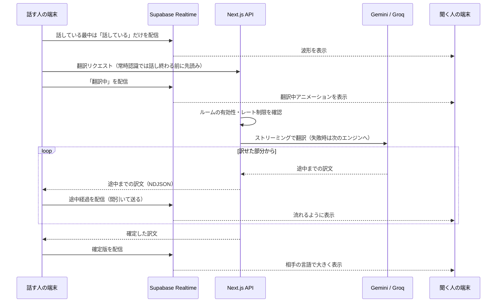

※この文書は本番版の説明です。このリポジトリはデモ版のため、翻訳APIの呼び出しと合言葉によるルーム作成の保護は無効にしています（詳しくは [README](README.md) を参照）。

# Tonari（トナリ）— Product Overview

> **QRコードひとつで、隣にいる人と母語のまま話せる。**
> 対面コミュニケーションの言語の壁を限りなくゼロに近づける、リアルタイム対面翻訳 Web アプリ。

このドキュメントは、コンテストの審査員の方や、本プロジェクトを理解しようとする AI アシスタント向けに、Tonari の狙い・体験・技術・設計判断をまとめたものです。セットアップ手順は [README.md](README.md) を参照してください。

---

## 1. プロダクト概要

### 課題：翻訳アプリは「会話」を止めてしまう
旅先の店頭、インバウンド客の接客、留学生や外国籍の同僚との初対面。対面で翻訳アプリを使うと、1 台のスマートフォンを相手と交互に受け渡し、画面をのぞき込み合うことになります。

- 端末の受け渡しで **会話のテンポが途切れる**
- 画面ばかり見て **相手の表情が見えない**
- アプリのインストールや言語設定を **相手にも求める** ことになる

### 解決策：「それぞれの端末で、それぞれの言語で」
Tonari では、2 人がそれぞれ自分のスマートフォンを持ち、自分の言語で話します。翻訳は裏側で行われ、相手の画面には **相手の母語で、大きく** 表示されます。

| | 従来の翻訳アプリ | Tonari |
|---|---|---|
| 端末 | 1 台を交互に受け渡す | 各自の端末で同時に |
| 相手の準備 | アプリのインストール・設定 | QR コードを読むだけ（インストール・登録不要） |
| 言語設定 | 相手が自分で選ぶ | QR に埋め込まれて自動設定 |
| 視線 | 画面に集中 | 相手を見たまま話せる |

### 一言でいうと
**「話しかけたら、相手のスマホに相手の言葉で届く」。** それ以外の操作を、極限まで削ぎ落としました。

---

## 2. コア体験

### ① QRコードで、すぐにつながる
1. **ホスト** が自分の言語と相手の言語を選び、「ルームを作成」をタップ
2. 画面に出た QR コードを **ゲスト** がカメラで読み取る
3. その瞬間、ゲストの画面は **すでに相手の言語に設定された状態** で開き、会話が始められる

- ルームは推測不可能な **UUID v4** で発行され、ゲスト用 URL に相手の言語が埋め込まれています。
- 2 台の端末は **Supabase Realtime** の専用チャンネルで 1 対 1 に結ばれます（P2P のように 2 台が直接つながる体験を、サーバー中継で安定して実現しています）。
- QR を見せられない場面のために、「🔗 リンクをコピー」で招待リンクを渡すこともできます。
- つながった瞬間、両方の画面に **紙吹雪** が舞い、「接続完了！会話を始められます」と知らせます。
- ルームを作れるのは **合言葉を知っているホストだけ** です（[安全性とプライバシー](#安全性とプライバシー)）。ゲストは QR を読むだけで、合言葉も登録も要りません。

### ② 環境に合わせて選べる 2 つの入力モード
入力欄の左にある **セグメントスイッチ** をワンタップするだけで、状況に合わせてモードを切り替えられます。

| モード | 向いている場面 | 体験 |
|---|---|---|
| 🎙 **常時認識（ハンズフリー）** | 静かな場所での自然な会話 | ただ話すだけ。話し終わると自動で翻訳・送信され、すぐ次の発話を待つ。**ボタン操作はゼロ** |
| ⌨ **手動** | 騒がしい場所、内容を確かめて送りたいとき | キーボード入力に加え、入力欄の中のマイクで **音声入力（自動送信しない）** もできる。確かめてから ➤ で送信。周囲の雑音による誤送信を防ぐ |

- モードの選択は端末に記憶され、次回もそのまま使えます。
- 手動モードの音声入力は、マイクをタップしたときだけ始まり、もう一度タップすると止まります。文字を入力した後でも、マイクを押せば **その後ろに何度でも追記** できます（「話す → 確かめる → 足りなければ追記 → ➤」）。
- 相手のメッセージを読み上げている間は常時認識を自動で一時停止し、**読み上げた音声を自分の発言として拾ってしまう誤認識を防ぎます**。
- 相手のマイクが声を拾っている間、こちらの画面には **波形が揺れる吹き出し** が出ます。送信される前から「いま話してくれている」ことが分かります（話している内容は送らず、「話しているかどうか」だけを共有します）。

### ③ 待たされない翻訳
- **楽観的 UI**：送信した瞬間に自分の吹き出しが表示され、相手の画面にも iMessage のように **3 つのドットが波打つタイピングインジケーター** が先に届きます。「翻訳中」という文字は出さず、動きだけで「いま裏側で AI が訳している」ことを伝えます。
- **訳せた部分から少しずつ届く**：翻訳はストリーミングで生成し、訳せた部分から相手の画面に **流れるように表示** します（末尾でカーソルが点滅）。確定すると、そのまま確定版に置き換わります。
- **話し終わる前から訳し始める（先読み翻訳）**：常時認識モードでは、認識途中の文が 450ms 変わらなければ、話し終わりを待たずに翻訳を始めます。送る文が同じなら、その結果をそのまま使います。
- **速さで選んだ AI と、マルチ AI フォールバック**：対面の会話はテンポが命なので、「最初の文字が出るまでの速さ」で主エンジンを選んでいます。計測では、Gemini Flash-Lite が約 0.8 秒、思考を挟む Gemini Flash は 6〜10 秒だったため、Flash-Lite を主エンジンにしました。エラー・タイムアウト・利用上限の際は待たずに Groq の別モデルへ自動で切り替え、途中まで訳していた場合は途中経過を消して訳し直します。1 つの AI が混雑していても会話は止まりません。
- **速さを数字で見せる**：URL に `?metrics=1` を付けると、送信してから最初の文字が出るまで・訳し終わるまでの中央値と 90% 値を画面の隅に表示します。
- **旅行会話に最適化したプロンプト**：「旅行中の対面会話であること」を前提に、ニュアンスを崩さない自然な口語体で訳すよう指示しています。
- 受け取った翻訳文はワンタップで、その言語の音声で読み上げられます。

### ④ 通信が途切れても会話が止まらない
- **送信待ちの列**：圏外やオフラインのときに送った発言は「🕒 送信待ち」として残り、つながったら **送った順に自動で送信** されます。つながっているはずなのに通信に失敗したときも、間隔を空けながら数回まで自動で送り直します。
- **再接続したら取りこぼしを埋める**：Realtime が再接続すると、互いに直近の発言を送り合い、切れている間に届かなかった分を補います。同じ発言が何度届いても二重には表示されません。
- **再読み込みしても会話が消えない**：会話はその端末のタブに残すので、再読み込みや OS によるタブの破棄の後も続きから表示されます。
- **一瞬の切断で終わらせない**：相手の通信が一時的に切れても 30 秒は戻ってくるのを待ち、ゲスト画面をすぐに「終了」にしません。
- オフライン中はヘッダーと入力欄で知らせ、常時認識は一時停止して、つながったら自動で再開します。

### ⑤ 13 言語に対応
日本語・韓国語・英語・中国語（簡体字／繁体字）・スペイン語・フランス語・ドイツ語・イタリア語・ポルトガル語・タイ語・ベトナム語・インドネシア語。画面の文言もすべて 13 言語に翻訳済みです。

---

## 3. 技術スタック

| 領域 | 採用技術 | 採用理由 |
|---|---|---|
| フレームワーク | **Next.js 16**（App Router）／ **React 19** ／ **TypeScript** | 画面と API（Route Handlers）を 1 つのコードベースで型安全に扱える |
| スタイリング | **Tailwind CSS v4** | `dvh` による高さ制御やアニメーションをクラス単位で細かく調整でき、デザインの微調整が速い |
| リアルタイム通信 | **Supabase Realtime**（Broadcast / Presence） | メッセージ配信（Broadcast）と入退室・言語の同期（Presence）を 1 チャンネルで実現 |
| データベース | **Supabase Postgres** | ルームの有効性管理。RLS でブラウザからのアクセスを完全に遮断 |
| 翻訳 | **Google Gemini**（`@google/genai`）＋ **Groq** | 応答の速い主エンジンと、別プロバイダの予備エンジンによる冗長化。どちらもストリーミングで生成 |
| 音声 | **Web Speech API** | 音声認識・読み上げをブラウザ標準機能で実現し、インストール不要を貫く |
| QR コード | `qrcode.react` | SVG で生成し、どの画面密度でもくっきり表示 |
| ホスティング | **Vercel** | HTTPS（音声入力の必須条件）を標準で提供 |

### データの流れ

通信が切れている間に送った発言は話す人の端末で送信待ちになり、つながってから同じ流れで送られます。再接続したときは、互いに直近の発言を送り合って取りこぼしを埋めます。

### 安全性とプライバシー
- **会話をサーバーに保存しない**：メッセージは端末間をリアルタイムに流れるだけで、データベースには一切残りません。再読み込みに備えた会話の控えは、その端末のタブの中（sessionStorage）にだけ置き、タブを閉じれば消えます。
- **API キーをブラウザに渡さない**：翻訳 API の呼び出しはすべてサーバー側で行います。
- **ルームを作れるのはホストだけ**：翻訳の費用は運営者の負担なので、ホスト画面とルーム作成 API は **合言葉** で守っています。合言葉が合うと、署名付きの Cookie（JavaScript からは読めない）を 30 日間渡し、合言葉を変えれば発行済みの Cookie はすべて無効になります。合言葉の試行回数にも上限があります。
- **終わったルームは使えない**：ホストが終了ボタンを押すかページを閉じるとルームを無効化し、以後の翻訳リクエストはサーバーで拒否します。閉じ忘れても 12 時間で自動的に失効します。
- **なりすまし・乱用対策**：ルームの終了はホストだけが持つトークン（サーバーにはハッシュのみ保存）で認証し、翻訳とルーム作成にはレート制限をかけています。
- **話している内容は先に送らない**：相手に波形を出すために共有するのは「話しているかどうか」だけです。

---

## 4. UI/UX のこだわり

### 「説明書不要」の直感性
Tonari の画面には、操作方法を説明する文章がありません。**説明が必要な UI は、UI の側が負けている** と考え、状態そのものを見た目で伝える設計に徹しました。

- **常設バナーやガイド文を撤廃**：開発途中には「マイクを押して話してください」といった案内バナーがありましたが、すべて取り除きました。
- **接続状態はドット 1 つで**：ヘッダーの隅に 🟢 接続済み／🟡 待機中／🔴 エラー・オフライン を色と一言で表示します。
- **物理スイッチのような手応え**：モード切替は iOS のセグメントコントロールに倣い、薄いグレーの溝の上を、白いつまみが影を落として滑ります。押せるもの・切り替わるものが一目で分かります。

### 押したくなる、触り心地のいい UI
- **物理ボタンの世界観で統一**：アクションボタンはすべて、下辺に厚みを持たせた立体ボタンです。押した瞬間に厚みの分だけ沈み込み、バネのように戻ります。ルーム作成中もボタンをグレーにせず、青いまま沈んだ状態で 3 つのドットが弾みます。
- **枠線ではなく影で浮かせる**：カードや吹き出しから枠線をなくし、ごく薄く広がる影で空間に浮いているように見せています。
- **入力バーは 1 つのカプセルに**：モード切替・入力欄・送信ボタンをひとつの丸いカプセルに収め、内側と外側の角の丸みをそろえています。
- **手に伝わるフィードバック**：ボタンを押したとき・送信・受信・接続のときに、それぞれ違う長さで短く振動します（振動に対応した Android 端末）。送信すると、送信ボタンの紙飛行機が飛んでいきます。
- **音は鳴らさない**：効果音はマイクが拾って自分の発言として誤認識してしまうため、あえて使っていません。
- **柔らかい配色**：対面で相手を緊張させないよう、青と赤は彩度を落とし、空色・コーラル寄りの柔らかいトーンにしています。

### プレースホルダーとアイコンによる視線誘導
ユーザーの視線が必ず向かう **入力欄そのもの** を案内役にしました。

| 状態 | 入力欄に表示される文言 |
|---|---|
| 手動モード | 入力、または🎙で話す… |
| 常時認識モード・手動モードの音声入力中 | 話しかけてください… |
| 読み上げ中（聞き取り一時停止） | 一時停止中… |
| 相手がまだ接続していない | 相手を待っています… |
| オフライン | オフライン — つながったら送ります… |

- **送信ボタンは「押せるときだけ」点灯**：未入力時は薄いグレーで沈み、1 文字入力した瞬間に鮮やかなブルーに変わって、次に押すべき場所を示します。
- **常時認識中は「聞いている」ことが見える**：入力欄の右端で小さな赤いランプがゆっくり明滅し、波紋を広げます。ボタンの形をとらない「ランプ」なので、押すべきものと誤解されません。
- **右端は常に「送信（➤）」**：手動モードの音声入力のマイクは、送信ボタンとは別に入力欄の中へ常設しています。文字が入った後でもマイクが消えないので、送信する前にいつでも追記できます。録音中はマイク自体が赤く光ります。
- **赤枠を使わない**：Web の UI で赤い枠は「入力エラー」を意味します。録音中でも入力欄の枠はニュートラルな色のままにし、話している人に無用な焦りを与えません。
- **システムにロックされない**：雑音の多い会場や屋外では、AI が「話し終わり」を検出できないことがあります。常時認識中の送信ボタンは、文字がまだ出ていなくても押せる **「発話の強制確定」ボタン** として働き、ユーザーの意思でいつでも処理を進められます。ブラウザが確定に応答しない場合も、1.5 秒後に認識を打ち切って画面上の文を送る二段構えにしています。
- **招待リンクも 1 ボタンに**：長い URL をそのまま見せず、「🔗 リンクをコピー」ボタンだけを置いています。

### チャット領域の最大化
- 入力エリアは **モード切替・入力欄・送信ボタンを 1 行のカプセル** に収めました（中の部品は高さ 44px）。入力欄は文章に合わせて 1 行から自動で伸び縮みします。
- 設定パネルはネイティブアプリの設定画面のような区切り線付きのリスト形式にしています。**相手が接続すると自動で畳まれ**、チャットが画面いっぱいに広がります。

### 仮想キーボード展開時もレイアウトを崩さない
モバイルブラウザでは「キーボードを開くとチャットが潰れる」「スクロールが固まり、ピンチで拡大・縮小すると直る」といった不具合が起きがちです。Tonari ではこれを構造から防いでいます。

- **`100dvh` による画面全体の高さ制御**：画面を `h-dvh` の縦方向 flexbox で組み、ヘッダーと入力エリアは固定、**スクロールするのはメッセージ一覧だけ** にしています。アドレスバーやキーボードの出し入れに高さが追従します。
- **Android**：`interactive-widget=resizes-content` を指定し、キーボード表示時にレイアウトごと縮めて入力欄をキーボードの上に保ちます。
- **iOS**：キーボードを閉じた後にページ位置がずれたまま残る Safari の挙動を検知し、位置を原点に戻してタップやスワイプのずれを防ぎます。
- **`scrollIntoView` を使わない**：ページ全体まで巻き込んでスクロールさせないよう、メッセージ一覧のコンテナだけを動かします。
- **`overscroll-behavior` の制御**：一覧のスクロールがページに伝わってバウンスしたり、引っ張って更新でルームが切れたりしないようにしています。
- 入力文字は 16px 以上にし、iOS でフォーカス時に勝手に拡大されるのを防いでいます。

### LINE ライクなスクロール
- 一番下にいるときだけ新着メッセージに自動で追従します。
- 過去ログを読んでいる最中に新着が届いた場合は、位置を保ったまま **「↓ 新しいメッセージ」** ボタンを表示し、タップか一番下までのスクロールで消えます。
- 翻訳完了で吹き出しが伸びたときや、キーボードの開閉で表示領域が変わったときも、一番下にいれば一番下に留まります。

### 誰にとっても使いやすく
- アイコンだけのボタンにはすべて読み上げ用のラベルを付け、接続状態はスクリーンリーダーにも通知します。
- 「視差効果を減らす」を設定している端末では、波紋・明滅・波形・紙吹雪のアニメーションを止め、タイピングインジケーターと波形は上下に動かさず明るさの変化だけで「進行中」を伝えます。
- ダークモードに対応しています。

---

## 5. まとめ

Tonari が目指したのは、**翻訳アプリを使っていることを忘れるほど自然な対面会話** です。

- **つながるまで**：QR コードを読むだけ。インストールも登録も言語設定も不要
- **話すとき**：話しかけるだけ。ボタンも説明文も意識させない
- **待つとき**：話している気配から訳文まで、途切れずに届く。訳せた部分から流れるように表示される
- **どんな端末でも**：キーボードを開いても、長く話しても、画面が崩れない
- **どんな通信状況でも**：圏外になっても発言は消えず、つながれば自動で届く

技術の存在を感じさせず、目の前の相手との会話そのものに集中できること。それが Tonari の考える「最高の翻訳体験」です。
